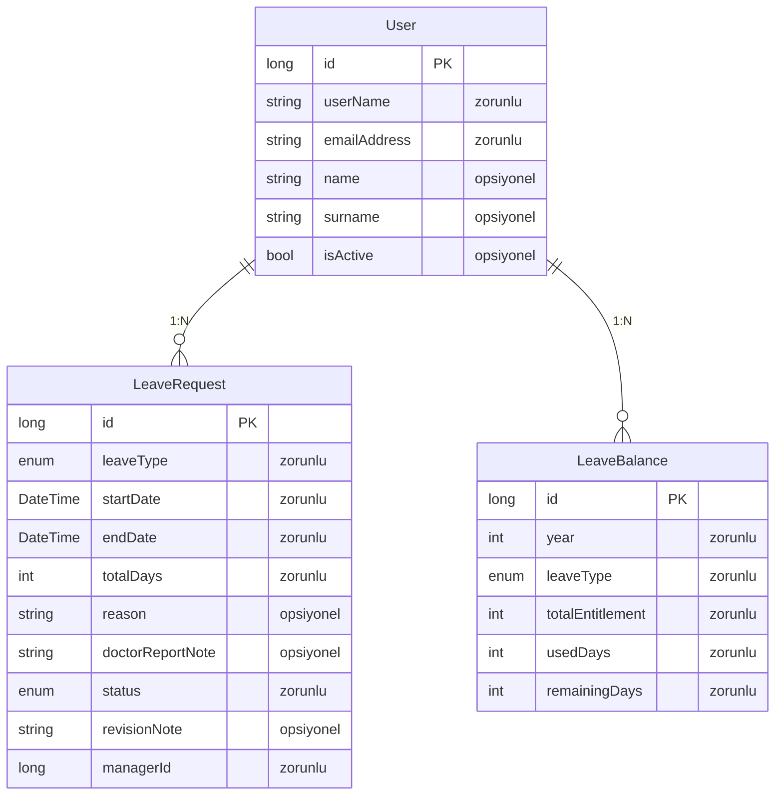
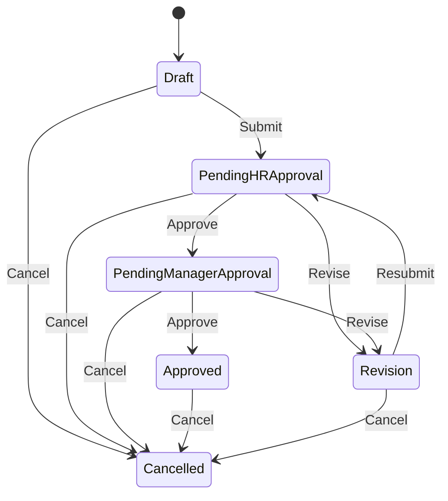
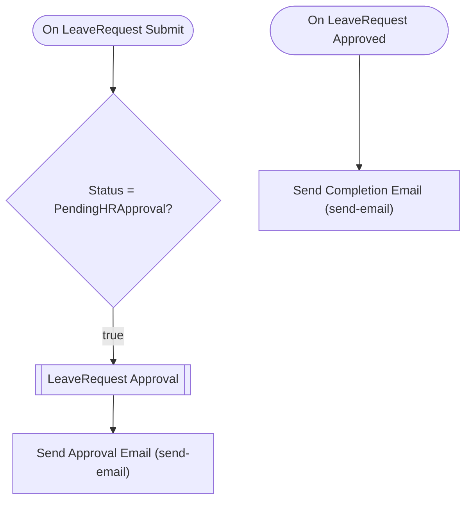

# i̇zin-yönetimi — Talep Analizi

> Bu belge Archipid talep olgunlaştırma (discovery) akışıyla üretildi.

## Orijinal Talep

izin talep sistemi istiyorum kullanıcı izin talebi oluşturacak önce ik onayına sonra yönetici onayına düşecek

## Özet

Bu uygulama çalışanların izin taleplerini dijital ortamda oluşturmasını, İK ve atanmış yönetici onayından geçirmesini, izin bakiyelerini takip etmesini ve onaylanan izinleri listelemesini sağlar.

Çalışan bir izin talebi oluşturup yöneticisini seçerek gönderir. Talep önce İK uzmanının onayına düşer; İK onaylarsa çalışanın formda belirttiği yöneticiye iletilir. Yönetici de onaylarsa izin kesinleşir. Herhangi bir adımda revize istenirse talep çalışana geri döner, düzeltip yeniden gönderebilir. İptal her aşamada mümkündür. İK uzmanı, çalışanların yıllık izin bakiyelerini LeaveBalance kayıtlarından takip eder ve onay sonrasında manuel olarak günceller.

## Kapsam

- (belirtilmedi)

## Kapsam Dışı

- (belirtilmedi)

## Açık Noktalar

- (belirtilmedi)

## Eksiklikler

- (belirtilmedi)

## Öneriler

- (belirtilmedi)

## Veri Modeli

### User — Kullanıcı (Sistem)

| Alan | Tip | Zorunlu | Uzunluk |
|---|---|---|---|
| `id` | long | Evet | — |
| `userName` | string | Evet | 64 |
| `emailAddress` | string | Evet | 256 |
| `name` | string | Hayır | 128 |
| `surname` | string | Hayır | 128 |
| `isActive` | bool | Hayır | — |

**Neye bağlı:** LeaveRequest (1:N, bu tablo "bir" tarafı) · LeaveBalance (1:N, bu tablo "bir" tarafı)

### LeaveRequest — İzin Talebi

| Alan | Tip | Zorunlu | Uzunluk |
|---|---|---|---|
| `id` | long | Evet | — |
| `leaveType` | enum (Annual,Sick,Maternity,Paternity,Unpaid,Other) | Evet | — |
| `startDate` | DateTime | Evet | — |
| `endDate` | DateTime | Evet | — |
| `totalDays` | int | Evet | — |
| `reason` | string | Hayır | 1000 |
| `doctorReportNote` | string | Hayır | 500 |
| `status` | enum (Draft,PendingHRApproval,PendingManagerApproval,Approved,Revision,Cancelled) | Evet | — |
| `revisionNote` | string | Hayır | 1000 |
| `managerId` | long | Evet | — |

**Neye bağlı:** User (1:N, bu tablo "çok" tarafı)

### LeaveBalance — İzin Bakiyesi

| Alan | Tip | Zorunlu | Uzunluk |
|---|---|---|---|
| `id` | long | Evet | — |
| `year` | int | Evet | — |
| `leaveType` | enum (Annual,Sick,Maternity,Paternity,Unpaid,Other) | Evet | — |
| `totalEntitlement` | int | Evet | — |
| `usedDays` | int | Evet | — |
| `remainingDays` | int | Evet | — |

**Neye bağlı:** User (1:N, bu tablo "çok" tarafı)

## İş Akışları

### İzin Talebi — durum makinesi

**Onay adımları**

| # | Adım | Atanan | Aksiyonlar | Zorunlu alanlar |
|---|---|---|---|---|
| 1 | İK Onayı | Rol: `HRSpecialist` | Onayla (approve), Revize İste (revise) | `revisionNote` |
| 2 | Yönetici Onayı | Alan: `managerId` | Onayla (approve), Revize İste (revise) | `revisionNote` |

Reddedilirse kayıt **`Revision`** durumuna döner.

### Akış: LeaveRequest Approval Flow

Auto-generated approval flow for LeaveRequest. Customize email templates and add conditions as needed.

## Elle Geliştirme Gerektirenler

Aşağıdaki maddeler senaryonun gereği ama üretilen koda yansımıyor — kod yazılması gerekir.

| Alan | İş | Neden | Geçici çözüm |
|---|---|---|---|
| approval | Yöneticinin kendi çalışanının talebini onaylaması engellenmez | Organizasyon şeması bağlamı verilmediği için 'talep eden ile onaylayan aynı kişi olamaz' kuralı uygulanamaz. | managerId alanı, talebi oluşturan kişiden farklı bir kullanıcıya işaret etmeli; bu kontrol uygulama katmanında elle geliştirilmelidir. |
| entity | Toplam gün otomatik hesaplanmaz | Başlangıç ve bitiş tarihi farkından otomatik gün hesaplama desteklenmiyor; hesaplanan alan (tarih farkı) üretilemiyor. | Kullanıcı toplam gün sayısını manuel girer. |
| entity | Hastalık izninde doktor raporu dosya eki yüklenemez | Dosya/belge yükleme (attachment/file upload) field tipi bu sürümde desteklenmiyor. | Doktor raporu bilgileri (rapor no, tarih, hastane adı vb.) doctorReportNote metin alanına yazılabilir. |
| flow | Onaylanan iznin harici sisteme (HR yazılımı, takvim) otomatik aktarımı desteklenmiyor | Platform harici sistem entegrasyonu veya webhook tetikleme üretemiyor. Bu sürümde desteklenmiyor. | İK uzmanı onaylanan izinleri PDF raporu üzerinden düzenli olarak harici sisteme manuel aktarabilir. |
| flow | İzin bakiyesi onay sonrası otomatik güncellenmez | Kayıt durumu değişince başka bir kaydın alanını otomatik güncelleyen akış üretilemiyor. | İK uzmanı izin onaylandıktan sonra LeaveBalance kaydını manuel olarak günceller. |
